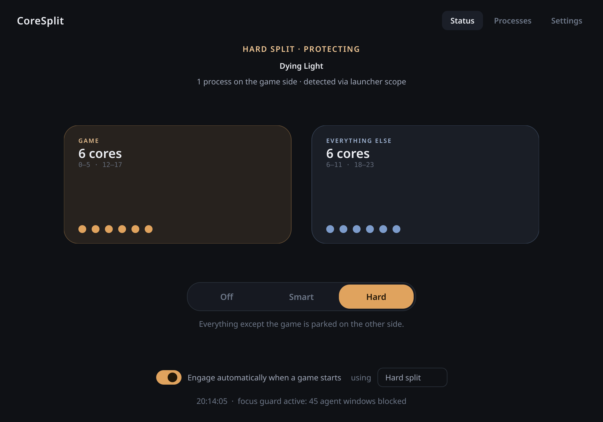

<h1>CoreSplit <br> <sub style="color: gray;">Play videogames without your agents making you lag, or stealing your cursor focus</sub></h1>



Your CPU is really two chips in one package, each with its own pool of fast
cache. A game only needs one of them. CoreSplit keeps everything else on your
PC (test runs, compiles, coding agents) on the other one while you play, and
puts it all back when you're done.

## The problem

When a test run or an agent works while you game, it competes with the game
for cores and your frame times spike. I was playing THE FINALS when all of a 
sudden my agent runs `vitetest`, my fps drops to 25-40, and I become infuriated.
it also likes to steal my mouse.

## The solution

While a game is running, CoreSplit moves your other programs to the other half
of the CPU, and moves everything back once you quit. It notices games through
GameMode, Steam/Lutris/Heroic install locations, or launcher processes.

- **Hard** (default): moves everything of yours off the game's half. It can't
  misidentify anything, so nothing slips through.
- **Smart**: moves only the stuff that looks like tests or agents.

A slider sets how many cores each side gets. Six and six is the default and
the best case, because then each side keeps its own cache to itself. Giving
the game more makes it use both halves at once, which is slower per core, so
only do that if a specific game really needs it.

The focus guard blocks agent windows from taking your mouse and keyboard while
you play. Your own alt-tab still works, and if you try to open a blocked
window twice within three seconds it gets through.

## How it works

A Python app with a PySide6 window. A background thread watches the process
list and, when a game shows up, rewrites the CPU affinity (the list of cores a
process may run on) of everything you own. Before touching a process it saves
the original affinity to a state file, so if the app crashes or gets killed,
the next start puts everything back the way it was. It never restores onto a
PID that now belongs to a different process. The window, tray icon and the
`coresplit` command all control the same background engine.

Cores are grouped by shared L3 cache instead of by number, so the odd core
layout of these chips (cores 0-5 plus 12-17 on one half) is handled correctly
and keeps working on other hardware.

## Install

Needs Linux, KDE Plasma (only for the focus guard), Python 3 with PySide6, and
`taskset`.

```bash
git clone https://github.com/20plays/coresplit.git
cd coresplit
./install.sh
```

No root, nothing outside your home folder. If PySide6 is missing:
`pip install PySide6` or `pacman -S python-pyside6`.

## Commands

```bash
coresplit                     # open the window (it hides to the tray on close)
coresplit smart|hard|off      # switch mode in a running instance
coresplit focusguard on|off   # toggle the focus guard
coresplit status              # what is it doing right now
coresplit detect              # which game does it see
coresplit reset               # unpin everything, even if the app died
```

`coresplit --tray` starts hidden in the tray, `coresplit daemon` runs without a
window. For games you play often, the Settings page gives you a `taskset` line
to paste into Steam launch options so the game is pinned before it even
starts.

## License

MIT
